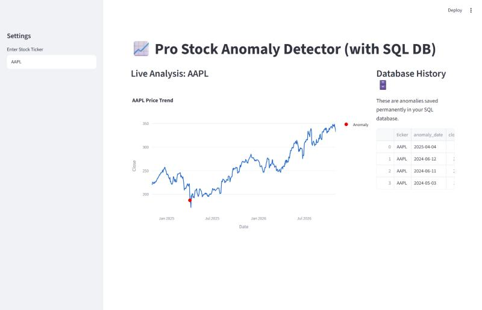
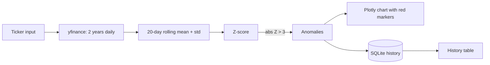

<h1 align="center">📈 Stock Anomaly Detector</h1>

<p align="center"><b>A Streamlit dashboard that flags statistically unusual closing prices with a rolling 20-day Z-score and keeps a SQLite history of every anomaly found.</b></p>

<p align="center">
  
  
  
  
  
  
</p>

<p align="center"><b><a href="https://stock-anomaly-detector.onrender.com">🚀 Live demo on Render</a></b> (free tier — the first load can take about a minute while the service wakes up)</p>

<p align="center"></p>

<p align="center"><sub>Local run on AAPL (two years of daily data, fetched 4 Nov 2026).</sub></p>

---

## 📌 Problem statement

Fixed price alerts ("tell me if AAPL drops below $150") ignore volatility: a 3% move is routine for one stock and extraordinary for another. A better question is *"is today's price unusual compared with this stock's own recent behaviour?"*

## 🎯 Objectives

- Fetch two years of daily prices for any ticker.
- Flag prices that are more than three standard deviations from their recent rolling mean.
- Show them on an interactive chart and keep a persistent, de-duplicated history.

---

## ⚙️ How it works

1. **Data** — `yfinance` downloads two years of daily OHLC data for the ticker typed in the sidebar (results are cached per ticker).
2. **Rolling statistics** — over a 20-day window, compute the rolling mean μ and standard deviation σ of the closing price.
3. **Z-score** — for each day, $Z = \dfrac{X - \mu}{\sigma}$.
4. **Decision** — a day is an anomaly when $|Z| > 3$.
5. **Persistence** — each anomaly is written to `anomalies.db` (SQLite) once; the sidebar table shows the saved history across sessions and tickers.



---

## 🛠️ Tech stack

| Category | Tools |
|---|---|
| Language | Python |
| Data | Pandas (rolling windows), yfinance |
| Visualisation | Plotly Express |
| Storage | SQLite (`sqlite3`) |
| App | Streamlit |
| Packaging | Docker (`python:3.9-slim`) |

---

## 🚀 Run locally

```bash
git clone https://github.com/SwarangiK-21/Stock-Anomaly-Detector.git
cd Stock-Anomaly-Detector
pip install -r requirements.txt
streamlit run main.py
```

### With Docker

```bash
docker build -t stock-anomaly-detector .
docker run -p 8501:8501 stock-anomaly-detector
```

Open `http://localhost:8501`. The app needs internet access to reach Yahoo Finance.

---

## 📂 Project structure

```
Stock-Anomaly-Detector/
├── main.py            # Streamlit app: data, Z-score, chart, SQLite history
├── Dockerfile         # Container image for the app
├── assets/            # Screenshot
├── requirements.txt
└── README.md
```

`anomalies.db` is created on first run and is not committed.

---

## 💼 Use cases

- Spotting earnings-day or news-driven moves in a watch list.
- A teaching example of rolling statistics and simple statistical anomaly detection.

## ⚠️ Limitations

- Uses daily closing prices only; it is not real-time or intraday.
- A rolling Z-score assumes roughly normal returns; fat-tailed markets produce more 3σ events than the rule implies, and the first 20 days have no score.
- Prices, not returns, are scored, so strong trends can trigger or hide anomalies.
- Not financial advice.

## 🔭 Future enhancements

- Score daily returns and volume as well as price, with an adjustable window and threshold.
- Compare against Isolation Forest or seasonal decomposition.
- Alerts (e-mail / webhook) for new anomalies on a watch list.

## 🤝 Contributing

Issues and pull requests are welcome.
